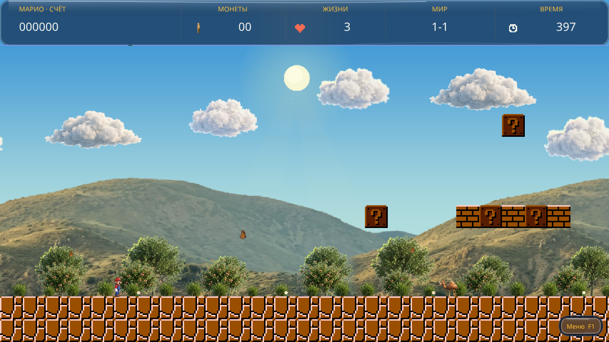

# Mario PC

Неофициальный порт для Windows x64 с русским интерфейсом, геймпадом, сохранениями, широким обзором и обновлённой графикой.

## Скачать и запустить

Откройте [последний выпуск](https://github.com/KausoV/MarioPC/releases/latest) и скачайте **MarioPC-Windows-x64-v2026.11.23.zip**. Распакуйте ZIP целиком и запустите **MarioPC.exe**. Файл **SDL3.dll** должен оставаться рядом. Установка, Python, внешний ROM и интернет для запуска не нужны. ZIP с `Source` предназначен для разработчиков.



## Управление

| Действие | Кнопка |
|---|---|
| Движение / приседание / трубы | Стрелки или WASD |
| Прыжок | Space или Z |
| Бег / огненный шар | X или левый Shift |
| Начать игру / нативная пауза | Enter |
| Игровое меню | Esc, F1 или Start на геймпаде |
| Полный экран | F11 или Alt+Enter |
| Снимок экрана | F12 |

Геймпад определяется автоматически: крестовина/левый стик — движение, нижняя лицевая кнопка — прыжок, левая — бег, Start — меню. Управление, монитор, разрешение и масштабирование настраиваются в меню. «Широкий обзор» показывает больше уровня без растяжения персонажей и блоков. Два игрока ходят по очереди.

Настройки и один слот сохранения находятся в `%APPDATA%\MarioPC\MarioPC`. При обновлении просто распакуйте новый выпуск в отдельную папку; ваши настройки и сохранение не включены в архив и не заменяются.

## Исходники и сборка

Код и исходные материалы находятся в [репозитории KausoV/MarioPC](https://github.com/KausoV/MarioPC) и в **MarioPC-Source-v2026.11.23.zip** на [странице этого же выпуска](https://github.com/KausoV/MarioPC/releases/tag/v2026.11.23). Потребуются CMake и Visual Studio 2026 с C++/Windows SDK. SDL3, Dear ImGui, шрифт и встроенные заголовки данных включены. В PowerShell из папки исходников выполните:

```powershell
.\build.ps1
```

Скрипт собирает игру, запускает 19 C++ наборов CTest и копирует EXE/DLL в корень. Для пересборки с имеющимися заголовками не нужны Python, FFmpeg или скачивание ресурсов. Python/Pillow/NumPy и FFmpeg нужны только для повторной обработки исходной графики инструментами `tools/`.

[Схема проекта](docs/project-map.html) · [Состав исходников](docs/SOURCE_NOTES.md) · [Проверка выпуска](docs/RELEASE_CHECKS.json) · [Происхождение и изменения](docs/PORT_NOTES.md) · [Лицензии](licenses/README.md)

## Происхождение и лицензии

Игровое C-ядро основано на [SMB-Vanilla](https://github.com/nukep/SMB-Vanilla); звуковая библиотека — Nes_Snd_Emu. Программная интеграция распространяется с исходниками под GPL-3.0, уведомления зависимостей сохранены в `licenses/`.

Марио, игровые образы и оригинальная игра принадлежат соответствующим правообладателям. Проект не является официальным продуктом Nintendo и не связан с Nintendo. Игровые данные и русский перевод Guyver от 24.11.2016 предоставлены владельцем проекта и встроены в сборку. Лицензии программных компонентов автоматически не распространяются на эти данные и изображения.
