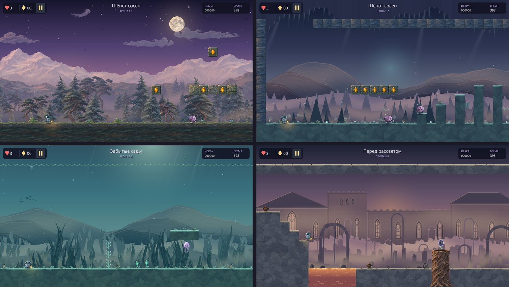

# Искра — Хранитель леса

Восемь лесных маяков погасли. У старой сосны маленький робот Искра поднимает фонарь, и в его свете на коре проступает первая метка. Пройдите 32 тропы, зажгите маяки и верните лесу рассвет. Вдвоём Искра и Луч проходят тропы по очереди.

**[Скачать игру для Windows x64](https://github.com/KausoV/MarioPC/releases/latest/download/Iskra-Windows-x64.zip)** · [Все выпуски](https://github.com/KausoV/MarioPC/releases)

Распакуйте ZIP целиком в папку и запустите **Iskra.exe**. Оставьте **SDL3.dll** рядом с игрой. После скачивания можно играть без интернета.



## Управление

| Действие | Клавиатура | Геймпад |
| --- | --- | --- |
| Движение | Стрелки или WASD | Крестовина или левый стик |
| Прыжок | Пробел или Z | Нижняя лицевая кнопка |
| Бег | Левый Shift или X | Левая лицевая кнопка |
| Меню паузы | Esc или F1 | Start |

В меню паузы можно сохранить игру, перечитать запись текущей тропы и настроить управление, экран, таймер и поведение противников. Чтобы включить неуязвимость, введите `immortality` на вкладке **Игра** и нажмите Enter.

[Заставка первой тропы](docs/iskra/chapter-opening.jpg) · [Переходы через дупла](docs/iskra/pipe-passages.jpg) · [Финиш у лесной сторожки](docs/iskra/finish-landmarks.jpg)

## Сборка из исходников

Потребуются CMake и Visual Studio 2026 с инструментами C++ и Windows SDK. В PowerShell из каталога проекта запустите:

```powershell
.\build.ps1
```

Скрипт собирает версию x64, запускает CTest и помещает Iskra.exe и SDL3.dll в корень проекта. SDL3, Dear ImGui, шрифт и подготовленные игровые ресурсы включены в репозиторий.

[Состав исходников](docs/SOURCE_NOTES.md) · [Проверка сборки](docs/RELEASE_CHECKS.json) · [Лицензии компонентов](licenses/README.md)
